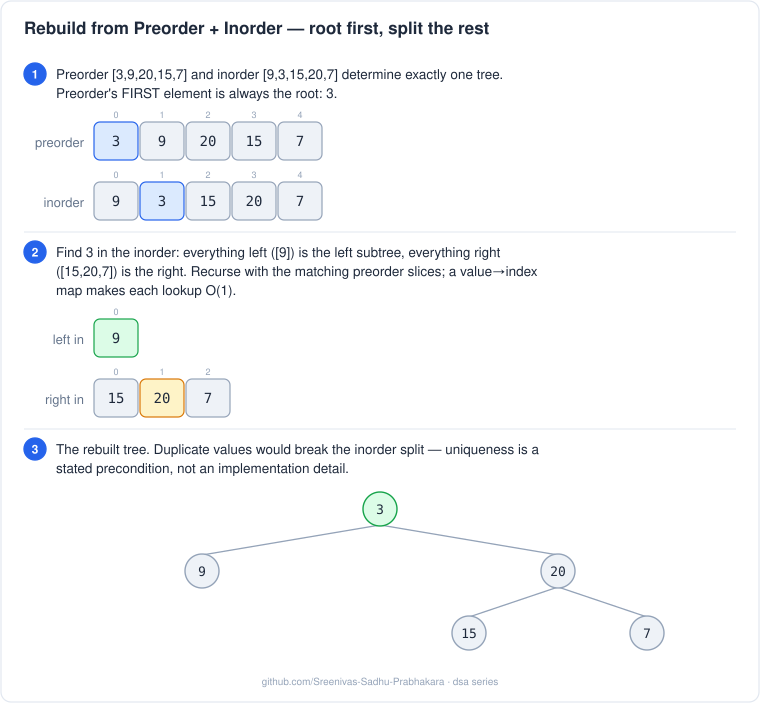

# Build Tree from Inorder + Preorder

> Striver SDE Sheet 125 · Day 19 Binary Tree III — preorder deals out roots in order; inorder's split around each root sizes the subtrees. One cursor, one hash map. Go, stdlib only, tested.

## Problem

Reconstruct the unique binary tree whose preorder and inorder traversals are given (distinct values — without distinctness the tree isn't unique).

## Approach

Two facts interlock: preorder's first element is always the current subtree's root, and that root's position in inorder splits the remaining values into exactly the left and right subtrees. The clean implementation keeps **one global preorder cursor** and recurses only on inorder windows: build left before right, and the cursor automatically advances past the left subtree's nodes — no arithmetic about preorder ranges at all. A value→index map makes each root lookup O(1) instead of a scan. The tests verify by round-trip: re-deriving both traversals from the built tree, rather than asserting a hand-drawn structure.

**Complexity:** O(n) time, O(n) map + O(h) recursion.

## Visual walkthrough

Read the picture top to bottom — each numbered frame is one moment of the algorithm
running on this repo's test example.

## Run

    go test ./...   # verify
    go run .        # demo

---

One of 191 repos solving Striver's SDE Sheet in Go — stdlib only, one problem per repo, every solution tested. Browse the set: [`dsa-*` repos](https://github.com/Sreenivas-Sadhu-Prabhakara?tab=repositories&q=dsa-&type=source).
